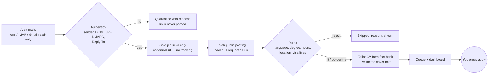

# job-alert-copilot

Reads the job-alert e-mails that LinkedIn sends to **your own** inbox, proves each mail is genuine, reads the public posting, decides with explicit rules whether you meet the requirements, prepares a tailored one-page CV and a short cover note from **your own verified facts**, and puts everything in a queue where **you** press apply.

> **It never applies for you.** No code path submits an application, clicks anything on linkedin.com, uses LinkedIn cookies or credentials, or sends e-mail. The furthest it goes is opening the posting URL in your default browser when you type `jac open <id>`. A test greps the source tree to keep it that way.

No GPU and no LLM are needed. The default path (keyword matching and fixed templates) gives a useful result on its own; a local LLM is an optional extra.

## Five-minute quick start

Python 3.10 or newer; Windows, macOS and Linux.

```bash
pipx install git+<repo-url>      # or: pip install .
jac demo                          # 1. see the whole thing on fake data, no account, no network
jac init                          # 2. answer a few plain questions
jac import-cv my_cv.pdf           #    draft your fact bank from a PDF or HTML CV, then read it
jac profile check                 #    what was understood, what is missing
jac doctor                        # 3. what still needs fixing, in plain words
jac run                           # 4. read mails, judge fit, prepare CVs and notes
jac dashboard --open              # 5. look at the result; apply yourself
```

Connecting your mail (step 3) has three options; `jac init` asks which one you want:

| Option | Effort | How |
|---|---|---|
| Folder of `.eml` files | none | save alert mails from your mail app into `<config dir>/mail` |
| IMAP with an app password | low | Gmail, Outlook.com, Yahoo, Fastmail presets. The password is asked at runtime and stored only in the OS keyring (the `keyring` package), never in a file and never logged. Access is strictly read-only: the mailbox is opened with EXAMINE and messages are fetched with `BODY.PEEK`; nothing is flagged, moved or deleted. |
| Gmail API | medium | create your own OAuth client in Google Cloud, save it as `client_secret.json` next to the config, `pip install "job-alert-copilot[gmail]"`; scope is `gmail.readonly` only |

Where the files go: config and profile in your user config directory, database, cache and output in your user data directory (via `platformdirs`). Use `jac --home some/folder ...` or the `JAC_HOME` variable to keep everything in one folder.

### What each command does

| Command | Purpose |
|---|---|
| `jac init` | wizard (or `--answers answers.yaml`) that writes `config.yaml` and `profile.yaml` |
| `jac import-cv FILE` | draft the fact bank from a `.pdf` or `.html` CV |
| `jac import-linkedin-export PATH` | draft it from the official LinkedIn "Download your data" archive (folder or zip) |
| `jac profile check` | print what was understood and what is missing |
| `jac doctor` | check Python, config, profile, mail connection (read-only), PDF browser, optional LLM |
| `jac run [--source eml\|imap\|gmail]` | the pipeline below |
| `jac list`, `jac show ID` | the queue |
| `jac open ID` | open the posting in your browser, status becomes `opened` |
| `jac mark ID applied\|skipped` | record what you did |
| `jac dashboard` | write `out/index.html` |
| `jac demo` | fake data, no network, opens the dashboard |

## How it works



1. **Mail authenticity first.** A message is processed only if it has exactly one From address, on exactly the site's domain and on the allowed list; the topmost `Authentication-Results` header (added by *your* provider, whose authserv-id you configure) shows `dkim=pass` for that domain, `spf=pass`, and `dmarc=pass` with `header.from` equal to that domain, and no failing SPF or DMARC result; and any `Reply-To` or `Sender` is on the same domain. Headers are read as received (encoded words are not decoded into addresses), and a header block Python cannot fully parse is refused. Otherwise the mail is quarantined with the reason and its links are never read. Display names are never trusted. The provider preset is required: without a trusted authserv-id the tool refuses to verify.
2. **Link safety.** Only `https` job-view links on exactly `www.linkedin.com` or `linkedin.com` are kept; every query parameter is dropped and the URL is rebuilt as `https://www.linkedin.com/jobs/view/<id>`. Shorteners, lookalikes, punycode, `user@host` tricks and redirects are rejected.
3. **Polite fetching.** Public guest page only, on-disk cache, one request per 10 seconds, 20 per run, plain User-Agent, stop on HTTP 429/999 or a login wall and mark the job "open manually".
4. **Rules decide.** Posting language, required languages, degree level, years of experience, hours, period, location, and visa or citizenship lines. All are driven by *your* profile (nothing is specific to one country). Visa lines are never auto-accepted or auto-rejected: the sentence is quoted and you decide. An optional LLM can only add notes or lower a verdict.
5. **No invented experience.** The CV is rendered from your fact bank; an LLM, if used, may only return IDs of existing facts and an order. The cover note is checked by a validator: every number, year, capitalised name and known technology must exist in your fact bank or in the posting's title, company or location (not its description, so "5 years of Docker" in a posting cannot become your claim); `never_claim` strings never appear, also not behind invisible characters, look-alike letters or HTML entities. After one retry it falls back to a fixed template. The check is a word filter, not understanding: see Limitations.
6. **Postings are data.** Posting and mail text sit in delimited blocks, the model has no tools, and its output must match a strict schema. Text hidden with HTML attributes or inline styles (`display:none`, zero size, off-screen, white text, clipping) is removed before anything reads it.

## Privacy

The repository contains no personal data. `profile.yaml`, `config.yaml`, `out/`, `cache/`, tokens and the SQLite file are git-ignored; `profile.example.yaml` describes a fictional person. Your mail is read only on your machine; the only network calls are to your mail provider, to the public LinkedIn guest page for postings, and, if you switch the LLM on, to the `base_url` you set (keep it a local server: a hosted endpoint would receive posting text and your facts). Nothing is sent to any other service. Cookies the posting page sets are refused, so none is stored or sent back. Passwords live in the OS keyring only. See `docs/threat-model.md`.

## Why it never submits for you

Application forms ask for claims you are responsible for, and automated submission or clicking on LinkedIn breaks its terms and gets accounts restricted. A human check is also the best defence against a wrong rule, a bad parse or a tampered posting. So the tool stops at "prepared" and you press the button.

## Optional: local LLM

Not needed. To try it, run an OpenAI-compatible server (LM Studio or Ollama) and set in `config.yaml`:

```yaml
llm:
  enabled: true
  base_url: http://localhost:1234/v1
  model: your-model-name
```

The LLM re-ranks facts (IDs only), extracts requirements for extra notes, and may draft the cover note; every output is validated. `jac doctor` checks the endpoint only when this is enabled.

## Adding another site (Indeed, Glassdoor, ...)

Each site is a `Source` in `src/jac/sources.py`: its sender domain, its allowed sender addresses and a `canonicalize(url)` function that accepts only that site's job links and returns a clean URL (or `None`). Register it in `SOURCES`, then `jac run --site yourname`. Verification, quarantine and queueing are generic. The posting fetcher currently reads LinkedIn's public page and JSON-LD, so a new site also needs its own `posting_page` URL rule and a check that its public pages may be read.

## Troubleshooting

| Symptom | Fix |
|---|---|
| `jac: command not found` | `pipx ensurepath` and open a new terminal, or use `python -m jac.cli` |
| Every mail is quarantined: "not a trusted receiver" | your provider's authserv-id differs. Open one genuine mail's raw headers, find the topmost `Authentication-Results: <id>;`, and put that id in `mail.trusted_authserv_ids` (a `*.example.com` form is allowed) |
| "no dkim=pass signed by linkedin.com" | the mail really failed authentication, or it was forwarded (forwarding breaks SPF). Use the original alert |
| IMAP login fails | use an **app password**, not your normal password; enable IMAP in the provider's settings; `jac doctor` shows the error type only |
| Wrong keyring password | `python -c "import keyring; keyring.delete_password('job-alert-copilot','you@mail')"` then run again |
| Job marked "open manually" | LinkedIn showed a login wall or rate-limited the page; the tool stopped on purpose. Open the posting yourself |
| No PDF, only HTML | install Chrome, Edge or Chromium, or set `pdf.browser_path` |
| CV is longer than one page | check that a browser is found (`jac doctor`); the fallback page estimate is rough |
| PDF import looks wrong | PDFs have no structure: read the draft in `profile.yaml`, fix it, run `jac profile check` |
| Gmail API asks to verify the app | it is your own OAuth client in testing mode; add yourself as a test user |

## Limitations and an honest note on terms

Alert mails contain only a few jobs, and the rules are keyword based: a clever posting can fool them, which is why borderline cases are shown with quoted evidence rather than decided. For example, "Fluent Dutch is required, English is a plus" (two clauses joined by a comma) is read as a soft mention. Language detection is a stopword ratio and works on postings of normal length.

The cover-note validator is a word filter. It does not catch a company or tool written in lower case ("i interned at globex"), a capitalised technology it does not know that also appears in the posting title, or a number from your fact bank reused in a false context ("16 projects" when 16 is your weekly hours). Read every note before you send it.

Hidden-text removal reads HTML attributes and inline styles only; CSS rules in `<style>` sheets are not evaluated.

Not yet tried against the real services: the Gmail OAuth flow, fetching postings from linkedin.com (LinkedIn's guest page may redirect or show a login wall, in which case jobs end up as "open manually"), and the local-LLM path. All of these are covered by tests with fakes only.

LinkedIn's terms restrict automated access; this tool is meant for personal, low-volume use of public pages only, one page per ten seconds, never logged in, and it stops at the first sign of a block. If you are unsure, skip fetching: open the links from the dashboard yourself. You are responsible for how you use it.

## Deviations from the original spec

- Tailoring modules live under `src/jac/tailor/`; the page-count check uses a real browser when available and a calibrated text estimate otherwise.
- IMAP search filters by sender domain and date on the server; the authenticity rules do the exact sender check afterwards.
- `Source` objects (see above) hold the sender and link rules, so `verify_message(msg, source, trusted_authserv_ids)` is generic.
- Outlook, Yahoo and Fastmail authserv-id presets are best-effort patterns; check them against one of your own mails (see Troubleshooting).
- Only the topmost `Authentication-Results` header is read, and if it is from an untrusted server the mail is refused instead of searching downwards for a trusted-looking one. This is stricter than "the topmost one whose authserv-id is the provider", which could pick up a forged header if the provider's own is missing. There is no default authserv-id.
- An LLM can lower "fit" to "borderline" but never rejects; only rules reject. Text aimed at AI readers lowers the verdict to "borderline" on its own.
- Degree rule: a master's or PhD requirement rejects, a "finished bachelor's before start" line is only borderline (it is often nominal for final-year students).
- Jobs whose posting could not be read get the verdict `manual` (status stays `new`).
- The cover-note validator accepts names and numbers from the fact bank and from the posting's title, company and location only, not from its description. This is stricter than "present in the fact bank or the posting": a requirement copied from a posting must not read as the user's experience.
- A mail also needs `dmarc=pass` with `header.from` naming the sender domain, no failing SPF or DMARC result in the trusted header, and a `Sender` header (if any) on the sender domain.
- The posting is fetched from its public canonical view URL; no unofficial LinkedIn API endpoint is used.
- Demo fixtures live in `src/jac/demo_data` so `jac demo` works from an installed package; `examples/eml` holds the same style of alert mails for `jac run --source eml --eml-dir examples/eml`.

## Development

```bash
pip install -e ".[dev,gmail]"
pytest -q          # no network, no LLM, no GPU
```

See `CONTRIBUTING.md`. MIT licence.
